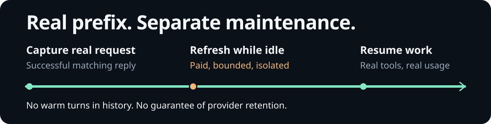

# Lifecycle and status

[← README](../README.md) · [Safety and compatibility](safety-and-compatibility.md) · [Verification](verification.md)

## A real request comes first

  

1. **Capture:** a successful foreground request supplies the actual provider payload and usable token accounting.
2. **Refresh:** while the native TUI is idle, an eligible in-memory snapshot is refreshed through a separate bounded request, or an explicit Google cache lease is renewed.
3. **Resume:** real user work takes priority. Hidden replies do not become session messages or extend the foreground response chain.

This is maintenance of an eligible prefix, not a promise that a provider will retain it. See [what the timer means](#what-the-timer-means).

## Defaults and commands

Both display and automatic warming start **on** when the extension loads. These switches are process-local, not saved preferences. `/cache warm off` is the explicit paid-refresh opt-out for the current process.

| Command | Effect |
| --- | --- |
| `/cache` | Enable the display, read the current branch's latest assistant usage, and start the status timer. Preserve the warming switch. |
| `/cache on` | Same as `/cache`; it does not undo `/cache warm off`. |
| `/cache off` | Hide status, stop its timer, and cancel/suspend warming. Preserve the warming switch. |
| `/cache warm` | Show warm state, next eligible schedule, call count, estimated inference cost, and any unpriced calls. Does not force a refresh. |
| `/cache warm on` | Re-enable paid automatic warming and acknowledge a paused snapshot. Preserve an existing deadline; the display must also be enabled. |
| `/cache warm off` | Disable paid warming and cancel an active refresh; keep cache visibility enabled. |
| `/cache warm now` | Attempt a paid refresh immediately when idle. All eligibility, safety, enablement, and shutdown guards still apply. |

`/cache warm now` is not an override. It cannot warm before a usable real request, during foreground work, while queued messages remain, with warming disabled, during a provider cooldown, or through an unsupported/unsafe API. It does not acknowledge a paused snapshot. It can force an explicit-cache renewal before its normal deadline, which can incur storage charges.

## Event-by-event behavior

### Start, restart, and resume

- Start with no replayable snapshot and no verified Codex chain. A saved assistant message can populate status, but cannot authorize warming.
- Complete a fresh, successful real request before maintenance is scheduled. Resume/restart does not change OMP's foreground chaining configuration.
- Warming requires an open **native TUI** with UI support. There is no background daemon, startup paid request, or headless refresh loop.
- The status uses OMP's managed one-second timer; it is not a second polling service. The warmer's call/cost ledger lasts for this extension process and is not reset when changing branches or sessions.

### Session, model, and branch changes

Session switch, branch, tree navigation, and compaction cancel active maintenance, clear the snapshot and verified chain, and reseed the display from the selected branch. A new real request is required.

The current model is checked on timer ticks and at request boundaries. A change of session/model identity invalidates captured state. A delayed refresh never reuses a previous model's credentials: API keys and optional transport headers are resolved again for the live model before sending.

### User turns and tool continuations

`before_agent_start` cancels any refresh and marks foreground work active. Each `turn_start` opens a new capture window for the real request, including legitimate tool continuations.

The awaited `assistant_message` settles the request and closes the capture window. Native background title requests arriving after settlement cannot replace that candidate. Delayed message notifications and HTTP headers carry no request identity and cannot prove ownership.

Only a successful, matching reply with finite, nonnegative input/cache accounting can authorize an unambiguous snapshot. Distinct payloads before settlement make that turn unavailable, even if successful HTTP headers arrive between them. This includes some native pre-stream reasoning/strict-tool rebuilds and overlapping same-model background requests. A subsequent eligible real turn can recover; the extension never guesses which prompt succeeded.

Errors and aborted foreground replies do not schedule warming. `agent_end` releases the foreground gate. A timer deadline alone cannot send a request: the session must also be idle with no foreground work, queued messages, cooldown, operational pause, or active maintenance; identity, snapshot eligibility, and both switches must still match.

### Codex foreground chains

A full native wire request can seed the verified chain. A later delta is accepted only when its `previous_response_id` exactly matches the last verified foreground reply. The extension expands it from that foreground input plus native, replay-safe output—not from reconstructed chat history. Unproven or partially dropped output cannot authorize the next delta.

The final wire body is frozen after in-place payload-hook edits. Warm requests use an isolated WebSocket connection, remove the foreground response reference, retain cache-affecting fields, and append only a tiny hidden reply instruction. They never extend the real response chain. HTTP fallback and within-request transport retries are refused.

If OMP itself must recover a long-idle foreground chain by retrying or falling back to a full request, it remains OMP's behavior. Cache Control does not promise that all foreground requests stay incremental.

### Completion, misses, and failures

A bounded completed refresh is accepted only with usable cache-token accounting and a matching provider/model. Tool calls, images, oversized output, unusable accounting, unexpected completion, or a second send are refused. A refresh has a 45-second timeout and its isolated transport state is closed afterward.

- **Cache hit:** reported `cacheRead > 0` refreshes the estimated timing anchor and schedules the next upkeep.
- **Cache miss:** `/cache warm` reports the miss, expiry becomes unknown, and the countdown is hidden while the ordinary cadence continues. Do not claim the prefix was refreshed. A later scheduled hit restores the estimate.
- **Ambiguous failure:** network errors, HTTP 5xx, timeouts, and invalid output pause that snapshot without an automatic resend. Already-sent requests may still be billable. A new successful eligible real request clears the pause without changing manual opt-out.
- **Definitive HTTP 429 rejection:** at most three scheduled retries per snapshot, with 60-, 120-, and 240-second minimum delays. A later valid `Retry-After` (seconds or HTTP date) or `retry-after-ms` deadline wins. Success and manual re-enabling do not replenish this retry budget.
- **HTTP 402 or in-stream quota errors:** pause rather than replay accepted or potentially charged work. HTTP 402 imposes at least five minutes of cooldown; structured in-stream 429 also imposes cooldown but never authorizes an automatic retry.

Cooldown applies across this extension instance, including model/session changes and shutdown/start. `/cache warm now`, `/cache warm on`, and a new foreground request cannot bypass it. Paused work needs a new successful eligible foreground request or explicit `/cache warm on` acknowledgement; manual display/warming opt-outs still require their corresponding on commands.

A completed refresh schedules its successor no earlier than one heartbeat after completion. Missed timer ticks produce one due request, not a catch-up burst, and re-enabling warming preserves that deadline.

### Cancellation and shutdown

User work, manual off commands, context changes, and shutdown cancel maintenance through an abort controller and revision/identity checks. Async completions from old work cannot install a new deadline or chain. Cancellation cannot undo provider work or charges already incurred.

Shutdown clears the snapshot/chain/status, stops the timer, and closes active maintenance. It does not create a saved warm state to resume later. A new session on the same extension instance preserves manual switches and provider cooldown; a fresh extension process starts with defaults and no snapshot.

### Native warmer interception

While this extension is loaded in the native TUI, its `cache_warming_decision` handler returns `stop` for OMP's own warmer—even when `/cache off` or `/cache warm off` is active. This prevents two maintenance policies from racing or billing simultaneously. Non-TUI modes are not intercepted. Removing the extension returns control to OMP's native policy; an opt-out here is not a permanent global OMP setting.

## What the timer means

A `~` countdown is an **estimate**, never a server TTL or eviction guarantee. The provider owns retention. The conservative timing anchor begins at the foreground request's start; only reported cache reuse advances the warm anchor.

| Case | Scheduling and display |
| --- | --- |
| `openai-codex/gpt-6.1-sol` | A 25-minute upkeep cadence with an explicitly inferred 30-minute retention window. Neither is a backend lease. |
| Native cache markers or model metadata | Use a single unambiguous short/long TTL where available. Maintenance targets 90% of that interval, reserving a 10-second margin for intervals over 10 seconds. |
| Cache capability/use, but unknown TTL | Infer a **4-minute upkeep interval**. Hide the expiry countdown; 4 minutes is not a claimed cache lifetime. |
| Ollama `keep_alive` | Preserve native residency policy and shorten cadence if needed. Residency is not a KV-cache lease; TTL can remain unknown. Zero residency or a sub-one-second feasible cadence is unavailable. |
| Explicit Gemini/Vertex cached resource | Query and verify the resource's fixed expiry, then renew its lease near the deadline. Foreground reads do not postpone it. Metadata GETs do not renew it; renewal PATCHes can bill storage. |

Mixed short/long markers can leave TTL ambiguous. Where `promptCache` metadata exists, those declared durations inform the estimate; they are not evidence of guaranteed retention for the current prefix.

## Reading the status

The Custom status segment shows only the estimated cache-expiry countdown, such as `~29:50`. It has no cache icon, reuse percentage, token count, cost, or warm-state text. Other OMP status segments are unchanged.

The extension hides its own segment when there is no usable matching reply, no unambiguous expiry estimate, a warm miss, or an expired countdown. A hidden segment does not mean warming is disabled; upkeep can still be scheduled when TTL is unknown.

`/cache warm` retains the detailed warm state, reason, next eligible schedule, call count, estimated inference cost, and unpriced calls. Its cost ledger is separate from OMP's native footer; see [cost accounting](safety-and-compatibility.md#cost-accounting).

## Troubleshooting

**No cache status appears**  
Open `/settings` (or **Ctrl+,**) → **Appearance → Status Line**. Set **Status Line Preset** to `custom`; include `status` in **Left Segments** without replacing existing segments. Stock presets omit extension status. Check `/cache on`, complete a request on the selected model, and inspect `/cache warm`. No matching expiry estimate, unknown TTL, a warm miss, or an expired estimate deliberately hides this extension's countdown.

**Warm pending never becomes scheduled**  
Wait for a successful, sufficiently large/cacheable real request. Resumed history alone is insufficient. Finish queued messages and foreground tool work. `/cache warm` reports whether you are waiting for a prefix or the API is unavailable.

**Warm state is paused or cooling down**  
Read `/cache warm` for the reason and remaining cooldown. A successful eligible real request resumes maintenance automatically after an operational failure, but never reverses manual off or bypasses cooldown. Use `/cache warm on` only when intentionally acknowledging a paused snapshot. Do not repeatedly force paid requests as a diagnostic substitute.

**The timer disappeared, or a refresh missed**  
Providers can evict caches early. A countdown is not proof of retained storage; an expired estimate or cache miss hides the timer. Real request usage is the evidence of reuse.

**Another extension rewrites provider payloads**  
Load Cache Control **after** payload-transforming extensions. Later in-place edits are captured at settlement, but a later whole-body replacement is invisible to the public hook. Do not rely on ordering alone to make a whole-body-replacing extension compatible.

**Request-body debugging is enabled**  
`PI_REQ_DEBUG=1` suspends hidden warming. After removing it, complete a successful eligible real request or explicitly acknowledge the pause with `/cache warm on`. This guard prevents native diagnostics from persisting private warm prompts. It does not make foreground logging safe; review the host's logging policy separately.
